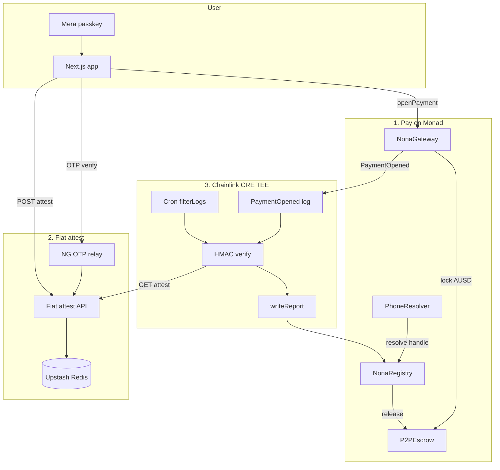

# NonaPay

**Cash App for AUSD remittances on Monad.**  
Passkey in → send to `@handles` / `+234` → dual-exit escrow → Chainlink CRE unlocks on OTP criteria.

| | |
| --- | --- |
| **Live** | [https://nonad-pay.vercel.app](https://nonad-pay.vercel.app) |
| **Pitch deck** | [https://nonad-pay.vercel.app/pitch](https://nonad-pay.vercel.app/pitch) |
| **Repo** | [github.com/emarc99/nonad-pay](https://github.com/emarc99/nonad-pay) |
| **Network** | Monad Testnet |
| **Track** | Metropolis · Consumer Products & Payments |

---

## Why it exists

Remittances still force seed phrases, `0x` addresses, and trust-me watchers. NonaPay keeps the UX invisible-chain (Mera passkeys + `@handles`) while settlement is **programmable**: Agora AUSD locks in escrow until a CRE confidential workflow verifies a `+234` OTP attestation. If CRE never releases, the payer **reclaims in 15 minutes**.

---

## Architecture



### Settlement path

1. **Pay** — passkey signs `openPayment`; AUSD locks in `P2PEscrow`; `PaymentOpened` emits.  
2. **Attest** — after `+234` OTP, app posts HMAC-signed attestation to the public relay (stored in Upstash on Vercel).  
3. **CRE** — log trigger (cron backup) loads Vault secrets, GETs attest, verifies HMAC in TEE.  
4. **Release or not** — `writeReport` → `NonaRegistry.onReport` releases on `approved=true`; missing attest skips write (pending); forged MAC → `RejectedReport`; silence → **15m reclaim**.

### Repo layout

| Path | Role |
| --- | --- |
| `frontend/` | Next.js PWA — Mera, send keypad, OTP, `/pitch` deck |
| `contracts/` | Foundry — Gateway, Escrow, Resolver, Registry |
| `workflow/` | CRE remittance workflow (`nonapay-remittance-staging`) |
| `blueprint/` | Specs, bounty matrix, submission paste pack |

---

## Monad Testnet deployments

| Contract | Address |
| --- | --- |
| AUSD | [`0xa9012a055bd4e0eDfF8Ce09f960291C09D5322dC`](https://testnet.monadexplorer.com/address/0xa9012a055bd4e0eDfF8Ce09f960291C09D5322dC) |
| AUSD faucet | `0xd236c18D274E54FAccC3dd9DDA4b27965a73ee6C` |
| NonaGateway | `0x421dCd87dc70d07589CA51200bf5Ec6065C12b8c` |
| P2PEscrow | `0x6C33f144264a480B3bd414Db39127deC91A3b69D` |
| PhoneResolver | `0x3953E210A6F81BBe5d9cAA0BD2Cc89dED255f95E` |
| NonaRegistry | `0x9693aAd2540D75057D0CDce4c16891230D335A6B` |
| Keystone forwarder | `0xF8344CFd5c43616a4366C34E3EEE75af79a74482` |

Explorer: [testnet.monadexplorer.com](https://testnet.monadexplorer.com)

---

## Quick start (local)

```bash
cp .env.example .env
# PRIVATE_KEY, FIAT_RELAY_AUTH_TOKEN, optional AFRICASTALKING_* / CRE_*

cd contracts && forge test

cd ../frontend && npm install && npm run dev
# → http://localhost:43127  (hostname must be localhost for WebAuthn — not 127.0.0.1)
```

Passkeys need a PRF-capable authenticator (e.g. Google Password Manager).  
In-app drip funds `MON` + AUSD from the deployer key (local/demo only).

### Fiat criteria (+234)

1. **Me** → `+234…` → Send OTP → Verify  
2. **Send** → `@alice` or `+234…` → app posts attestation  
3. CRE releases only if HMAC verifies  

On **Vercel**, set `FIAT_RELAY_AUTH_TOKEN` and Upstash (`KV_REST_API_URL` / `KV_REST_API_TOKEN` or `UPSTASH_REDIS_REST_*`) so OTP/attest survive serverless. Point CRE `fiatRelayUrl` at:

`https://nonad-pay.vercel.app/api/fiat/attest`

### CRE workflow

```bash
cd workflow
# Vault secrets: cre secrets create secrets.yaml --secrets-auth=browser --yes
cre workflow deploy remittance --target staging-settings --yes
```

Staging uses the **private** registry. Live name: `nonapay-remittance-staging`.

### Handles

| Input | Commitment |
| --- | --- |
| `@amina` | `keccak256("handle:amina")` |
| `+2348012345678` | `keccak256("handle:2348012345678")` |

---

> We built NonaPay for Metropolis to prove remittances can feel like Cash App while settlement stays honest: Agora AUSD on Monad, Mera passkeys for humans, and Chainlink CRE as the real criteria engine — not a fake watcher — with a 15-minute reclaim if the world goes quiet.
